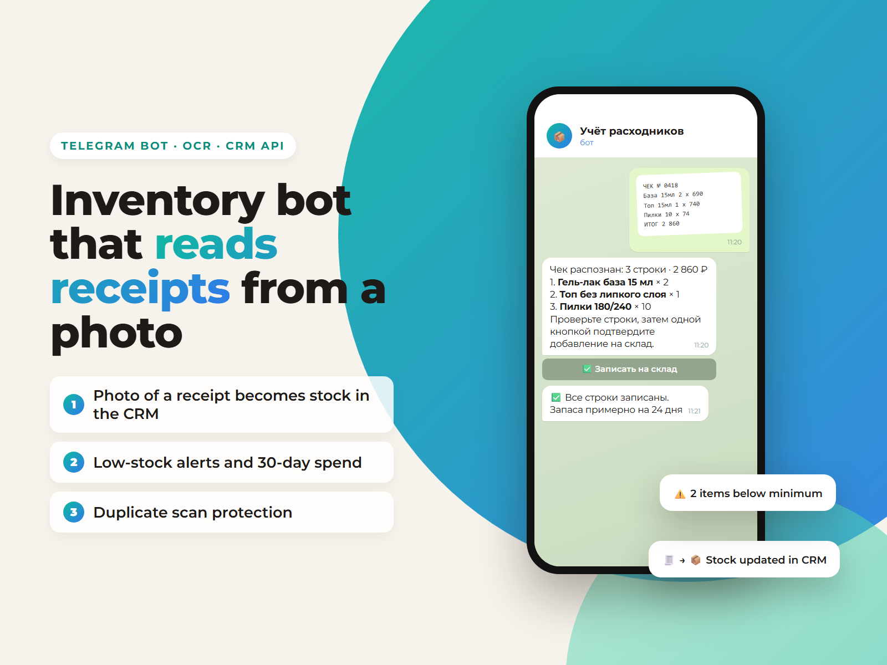

# Inventory Bot: receipt photo → stock in CRM



A Telegram bot for salon staff to track consumables. A photo of a receipt or product label is recognized by AI vision, the bot shows the lines for a quick check, and one confirmation writes them to the warehouse in the YClients CRM. In daily use at my own salon.

**Features**
- Photo intake: auto-detects receipt vs label, up to 3 photos per item merged into one SKU
- Receipt parsing: name, quantity, unit price, line total; arithmetic check, doubtful lines flagged
- Matching against the SKU catalog, category required for new items, manual `name | qty | price | sum` fallback
- One final confirmation, idempotent write, "continue" for partially failed receipts
- Duplicate-scan protection (barcode TTL), inventory counts by category
- Staff onboarding by one-time 6-digit code, every stock operation linked to an employee
- Hardened systemd unit (separate user, `ProtectSystem=strict`, secrets outside the code dir)

**Architecture:** `staff → bot (Python) → admin panel (Node.js, private) → YClients API`. The bot keeps no persistent stock data; the panel owns the write logic.

**Stack:** Python, aiogram 3, httpx, OpenAI Vision / local vision model, YClients API, systemd

## Tests

```bash
python test_parsing.py
python -m unittest test_scan_flow.py test_receipt_flow.py test_cycle_flow.py
```

Tests run without Telegram, OpenAI or YClients.

---

**Подробное описание на русском ниже.**

# Бот учёта расходников «Кудри»

Мастера вносят закупки и отмечают, что материал закончился. Карточка товара и
складская операция создаются прямо в YCLIENTS, на складе «Расходный материал».

## Как это работает

Постоянные складские данные бот не хранит. Он показывает кнопки и пересылает
ответы в панель `kudri-content`, а та уже пишет в YCLIENTS. В памяти процесса
бот держит только штрихкоды последних сканов на 10 минут, чтобы предупредить
о случайной повторной отправке фото. После перезапуска эта память очищается.

```
мастер → бот (Python) → панель kudri-content (Node) → YCLIENTS
```

## Что нужно заполнить

Файл `.env` рядом с кодом:

| Переменная | Что это |
|---|---|
| `BOT_TOKEN` | Токен нового бота от @BotFather |
| `KUDRI_API_BASE_URL` | Адрес панели: локально `http://127.0.0.1:3007` |
| `INVENTORY_BOT_API_KEY` | Общий ключ бота и панели — должен совпадать с тем же ключом в `.env` панели |
| `OPENAI_API_KEY` | Ключ OpenAI для распознавания этикеток и чеков (необязателен, если OCR не нужен) |
| `OPENAI_VISION_MODEL` | Модель OpenAI Vision, по умолчанию `gpt-4o-mini` |

Без `BOT_TOKEN` и ключа бот не запустится и скажет, чего не хватает.

## Запуск локально

```bash
python -m venv .venv
.venv/Scripts/python.exe -m pip install -r requirements.txt
.venv/Scripts/python.exe -m bot.main
```

Панель при этом должна быть запущена. Учтите: при `DRY_RUN=true` в настройках
панели операции в YCLIENTS **не уходят** — это защита от того, чтобы копия на
ноутбуке писала в боевую CRM.

## Что поменялось в UX

Фото можно отправить сразу в чат: локальный OAuth Vision определяет, чек это или
этикетка. Если уверенности нет, бот предлагает кнопки `🧴 Товар` и `🧾 Чек`.
После нажатия `📷 Сканировать этикетку` можно прислать до трёх фотографий одного
товара — например, лицевую сторону и отдельный штрихкод. Бот объединяет результат
в один SKU и показывает подтверждение:

- после распознавания существующего товара:
  - `✅ Это эта позиция`
  - `✏️ Это другой товар`
  - `Отмена`
- если повторное сканирование одинакового штрихкода за короткое время:
  - `➕ Добавить ещё раз`
  - `⏭️ Это дубль, пропустить`

Кнопки «создать дубль» нет намеренно: одинаковый штрихкод обозначает один SKU,
а backend в любом случае переиспользует найденную карточку. Если распознавание
ошиблось, пользователь вводит другое название, и бот снова сверяет его с базой.

Новая позиция обязательно получает категорию. Количество `1`, `2` или `5` можно
выбрать одной кнопкой; перед изменением остатка показывается итоговая карточка
`✅ Добавить на склад`. Кнопки главного меню сначала завершают прежний сценарий,
поэтому больше не могут стать названием товара или категории.

Старые служебные подсказки и промежуточный статус `Распознаю…` убираются из чата,
чтобы интерфейс не засорялся. При таймауте или иной ошибке бот всегда отвечает и
предлагает повторить распознавание либо перейти к ручному вводу.
Пользовательские фото и введённые сообщения бот не удаляет.

### Фото чека — этап 3 принят локально

Кнопка `🧾 Фото чека` запускает отдельный сценарий. Vision извлекает название,
количество, цену за единицу и сумму каждой строки, а также итог, дату и магазин,
только если они уверенно читаются. Бот проверяет арифметику, помечает сомнительные
строки, сверяет каждое название с каталогом SKU и показывает общий предпросмотр.
Для новой строки нужно выбрать категорию; розничный или лишний товар можно
исключить из складского прихода. Новая карточка SKU создаётся только при общем
подтверждении чека.

Любую строку можно исправить в формате
`Название | количество | цена за единицу | сумма`; неизвестное значение задаётся
знаком `?`. Если Vision недоступен или ключ не задан, тот же формат используется
для ручного ввода. Исходное фото не сохраняется и не удаляется из Telegram.

### Запись прихода по чеку — этап 8, локально, не выложен

Кнопка `✅ Проверить чек` отправляет выбранные строки в панель и получает
предпросмотр с короткоживущим токеном (остатки ещё не меняются). Затем
показывается **одно итоговое подтверждение** `✅ Добавить на склад`, и только
после него строки проводятся по очереди. Это работает как с YCLIENTS, так и с
самостоятельной внутренней базой организации.

После записи бот показывает построчный результат: что записано, что упало и
почему. Если часть строк не прошла, кнопка `🔁 Продолжить запись` дописывает
оставшиеся, не повторяя уже записанные. Повторное подтверждение того же чека
ничего не дублирует.

Ручной ввод строк — прежний fallback и в этом этапе не менялся. На сервере
запись включается вместе с `DRY_RUN=false`; холостой запуск по-прежнему ничего
не пишет. Отчёт: `ai-admin-mvp/docs/inventory-stage8-receipt-write-report.md`.

### Аналитика расхода — локальный этап 4, ожидает приёмки

Панель `Расходники` получает движения и текущие остатки напрямую из YCLIENTS и
считает показатели за 7, 30 или 90 дней. Отдельного журнала и второй базы
движений нет. Показаны приход, списание, чистое изменение, стоимость расхода,
тенденция, прогноз окончания по SKU и кандидаты, требующие внимания.

Средний дневной расход равен сумме операций списания за выбранный период,
делённой на число дней периода; приходы в расход не входят. Прогноз считается
как `текущий остаток / средний дневной расход` только при списаниях хотя бы в
два разных дня. Уверенность: 2–3 дня — низкая, 4–7 — средняя, 8 и больше —
высокая; при меньшей истории панель пишет «недостаточно данных».

Кандидат аномалии появляется, если средний расход в последней четверти периода
как минимум вдвое выше предыдущей части и вырос минимум на 1 единицу в день;
для базы нужны списания хотя бы в два разных дня. Никакие уведомления этот этап
не отправляет.

Складская дата YCLIENTS `YYYY-MM-DD HH:mm:ss` трактуется как время филиала по
`SALON_TIMEZONE_OFFSET_H`, а не как время сервера. Период — полные календарные
дни салона: начало первого дня включается, начало следующего дня исключается.
Поэтому операции вокруг полуночи не смешиваются в одном дне графика.

### Инвентаризация по категориям — этап 5, принят локально

`📋 Инвентаризация` показывает текущую категорию, срок и прогресс прохода.
Кнопки: «Начать/Продолжить», «Сверить SKU», «Повторная сверка»,
«Завершить категорию», «Обновить», «В меню». Для завершения вводится
`проверено SKU | расхождений`, затем показывается отдельное подтверждение.

Backend сохраняет результат с автором и датой; остатки YCLIENTS не меняются.
Предпросмотр `ID товара | фактическое количество` показывает разницу со свежим
остатком, но не создаёт корректировок. Это пока ручной ввод ID; выбор товара
через фото в сценарии сверки не реализован.

Меню редактируется, предыдущие подсказки удаляются. Прогресс переживает
перезапуск бота; незавершённый ввод чисел остаётся временным. Версия задания
защищает от старого подтверждения после повторной сверки.

Планировщик в Node включается `INVENTORY_CYCLE_SCHEDULER_ENABLED=true`.
Следующая категория назначается на завтра, после полного прохода следующий
цикл — через семь дней. Уведомления пока видны только в панели: отправка
отключена. Метаданные хранятся в tenant-файле `inventory-cycle.json`, а
остатки и движения продолжают жить только в YCLIENTS.

Полный отчёт: `ai-admin-mvp/docs/inventory-cycle-stage5-review.md`.
Локальная проверка: 73 Node-теста, 31 Python-сценарий, 8 проверок чисел.
Независимая приёмка оркестратора: полный npm test — 789 passed, 0 failed,
2 skipped; inventory 73/73 и Python 31/31 подтверждены.
На VPS этап не установлен; живой Telegram в этой проверке не использовался.

Подготовка установки выполнена отдельным этапом 6:
`ai-admin-mvp/docs/inventory-stage6-launch-runbook.md` и точный deployment
manifest. На VPS backend слушает порт 3000; стандартный bot service ещё не
создан. Перед запуском проверить прежний webhook/polling и политику
`drop_pending_updates`, ключ Vision и привязку только владельца.

## Проверки

```bash
python test_parsing.py
python -m unittest test_scan_flow.py test_receipt_flow.py test_cycle_flow.py
```

Первый файл проверяет разбор чисел. Второй без обращения к Telegram, OpenAI и
YCLIENTS проверяет фото-поток, TTL повторных сканов, очистку служебных
сообщений и payload прихода в backend. Третий проверяет OCR-fallback,
арифметические расхождения, частично распознанные строки, предпросмотр,
редактирование, отмену и отсутствие записи в YCLIENTS.

## Установка на сервер

1. Скопировать каталог в `/opt/kudri-inventory-bot`.
2. Завести пользователя `kudri-inventory-bot`, отдать ему каталог.
3. Создать `/etc/kudri-inventory-bot.env` с правами `600` и теми же тремя
   переменными.
4. Собрать venv и поставить зависимости.
5. Положить юнит из `systemd/` в `/etc/systemd/system/`, затем
   `systemctl daemon-reload && systemctl enable --now kudri-inventory-bot`.

Логи: `journalctl -u kudri-inventory-bot -f`.

## Как выдать доступ мастеру

В панели `/admin` → раздел **Расходники** → «Добавить». Панель спросит имя и
сотрудника YCLIENTS, потом покажет шестизначный код. Мастер вводит код в боте
один раз. Код действует сутки.

Связка с сотрудником YCLIENTS обязательна: складская операция не проводится
без указания, кто её сделал.
